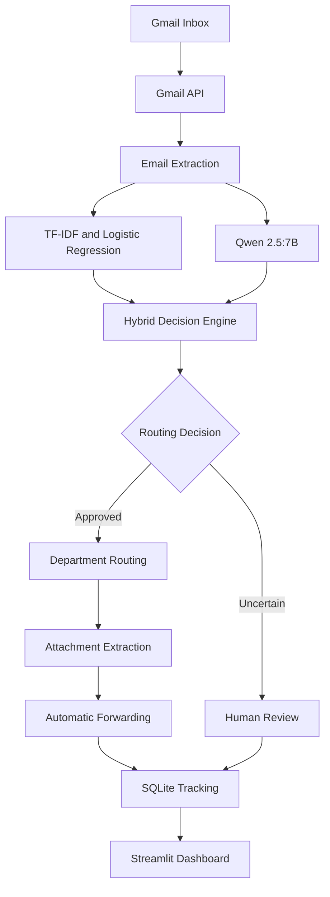
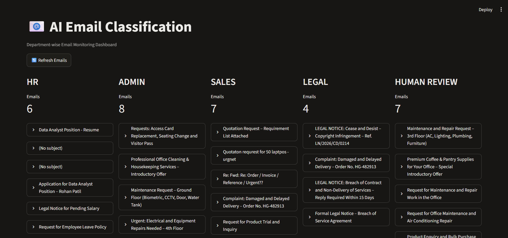

# AI Email Classification and Automatic Forwarding System

## Project Overview

An AI-powered email management system that automatically classifies incoming emails into HR, ADMIN, SALES, and LEGAL departments using a hybrid architecture combining traditional machine learning and large language models.

The system integrates Gmail API, SQLite, and Streamlit to automate email routing, attachment forwarding, processing-status tracking, and department-wise monitoring.

## Problem Statement

Manual email classification and departmental routing are time-consuming and susceptible to human error. Traditional text classification models may struggle with contextual ambiguity, while large language models introduce additional computational costs and inference latency.

This project explores a hybrid classification approach to balance contextual understanding, routing reliability, and automation efficiency.

## Key Features

- Automated email classification
- TF-IDF and Logistic Regression classification
- Context-aware classification using Qwen 2.5:7B
- Hybrid decision-making mechanism
- Human review for uncertain emails
- Gmail API integration
- Automatic departmental email forwarding
- Attachment-forwarding support
- SQLite-based duplicate-processing prevention
- Streamlit monitoring dashboard
- Secure configuration using environment variables

## Technologies Used

| Technology | Purpose |
|---|---|
| Python | Application development |
| Scikit-learn | Machine learning |
| TF-IDF | Text feature extraction |
| Logistic Regression | Statistical classification |
| Qwen 2.5:7B | Contextual classification |
| Ollama | Local LLM inference |
| Gmail API | Email retrieval and forwarding |
| SQLite | Processing-status tracking |
| Streamlit | Interactive dashboard |
| OAuth 2.0 | Gmail authentication |
| Python-dotenv | Environment configuration |

## System Architecture



## Model Experimentation

Multiple classification approaches were explored during development:

- Rule-based classification
- TF-IDF with Logistic Regression
- TF-IDF with Naive Bayes
- Semantic classification
- Neural network classification
- Sequential neural networks
- Functional neural networks
- LLM-based classification
- Hybrid ML and LLM classification

## Preliminary Evaluation

An earlier hybrid configuration was evaluated using 40 test emails, consisting of 32 clear and 8 ambiguous emails.

| Metric | Result |
|---|---:|
| Logistic Regression accuracy on clear emails | 90.63% |
| Qwen accuracy on clear emails | 93.75% |
| Hybrid correct automatic routes on clear emails | 27/32 |
| Hybrid incorrect routes on clear emails | 0/32 |
| Clear emails escalated for review | 5/32 |
| Ambiguous emails escalated for review | 6/8 |
| Ambiguous emails incorrectly auto-routed | 2/8 |
| Total human-review rate | 27.5% |

These preliminary results demonstrate the system's ability to escalate uncertain cases. Further controlled evaluation is required to establish the hybrid architecture's advantage over standalone classifiers with rejection thresholds.

## Project Structure

```text
email_classifier/
├── data/
├── models/
│   └── tfidf_lr_pipeline.pkl
├── src/
│   ├── hybrid_classifier.py
│   ├── gmail_connection.py
│   ├── gmail_auto_router.py
│   ├── gmail_forwarder.py
│   ├── gmail_monitor.py
│   ├── email_tracker.py
│   ├── email_routing_config.py
│   ├── streamlit_app.py
│   └── train_model.py
├── tests/
├── .env.example
├── .gitignore
├── requirements.txt
└── README.md
```

## Installation and Setup

### 1. Install dependencies

```bash
pip install -r requirements.txt
```

### 2. Install Ollama and download Qwen

```bash
ollama pull qwen2.5:7b
```

Ensure Ollama is running before starting the classifier.

### 3. Configure Gmail API

- Create a Google Cloud project.
- Enable Gmail API.
- Configure OAuth 2.0 authentication.
- Download the OAuth desktop client credentials.
- Save the credentials locally as `credentials.json`.

### 4. Configure environment variables

Create a `.env` file using `.env.example` as a template and configure your departmental email addresses.

### 5. Run the email monitor

```bash
python src/gmail_monitor.py
```

### 6. Launch the Streamlit dashboard

```bash
python -m streamlit run src/streamlit_app.py
```

## Security and Privacy

- Gmail authentication through OAuth 2.0.
- Private email addresses stored in environment variables.
- Credentials, authentication tokens, and local databases excluded from version control.
- Human-review mechanism for uncertain classification decisions.

## Current Limitations

- Limited evaluation dataset.
- LLM inference latency and computational requirements.
- Potential classification errors in ambiguous emails.
- Limited HTML email handling.
- Attachment forwarding requires further end-to-end validation.
- No guaranteed exactly-once delivery during processing failures.

## Future Improvements

- Confidence calibration for Logistic Regression.
- Selective LLM invocation for uncertain predictions.
- Comparative evaluation of standalone and hybrid classifiers.
- Latency and computational cost benchmarking.
- Improved human-review interface.
- HTML email support.
- Attachment security validation.
- Production deployment and scalable email processing.

## Project Status

Functional local prototype under active development and evaluation.

## Application Dashboard

The Streamlit dashboard provides a centralized interface for monitoring departmental email classification and human-review cases.


